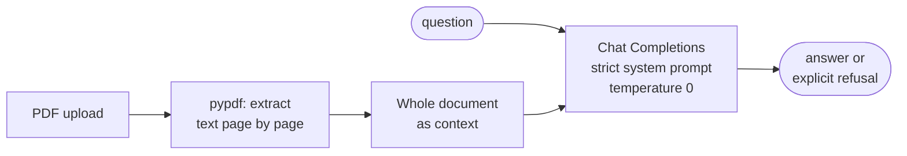

# Strict PDF Question Answering

**The smallest useful grounded QA system: answer questions about a PDF from its text alone, and say so plainly when the answer isn't in it.**

[](https://colab.research.google.com/github/dojedaro/strict-pdf-question-answering/blob/main/pdf_qa_strict_grounding.ipynb)
[](https://github.com/dojedaro/strict-pdf-question-answering/actions/workflows/notebooks.yml)

> Part of a series of RAG projects: **strict PDF QA** ·
> [PDF RAG + ReAct agent](https://github.com/dojedaro/pdf-rag-react-agent-langchain) ·
> [policy QA with evaluation](https://github.com/dojedaro/openai-rag-policy-qa-evaluation) ·
> [10-K retrieval evaluation](https://github.com/dojedaro/coca-cola-10k-retrieval-evaluation) ·
> [research-paper RAG](https://github.com/dojedaro/research-paper-rag-qa-system)

## Example run

On a mutual-fund factsheet (Nippon India Short Term Fund):

| Question | Answer | Behavior |
|---|---|---|
| What is the current investment strategy? | Invests mainly in corporate bonds, G-Secs and money-market instruments in the 1–5 year duration bucket… | grounded summary |
| What is the % of assets for Commercial Paper? | 0.82% | exact figure from a table |
| What is happening in Canada and Korea now? | "I cannot provide an answer as this information is not included in the PDF document." | refusal |

Three questions show the intended behavior; they aren't an evaluation (see next steps).

## How it works



There's no retrieval: the full text goes into every request. That keeps the system simple and makes
grounding easy to reason about, at the cost of a context-window limit on document size. The system
prompt forbids outside knowledge and fixes the refusal sentence, and temperature 0 keeps answers
repeatable.

## Run it

```bash
pip install -r requirements.txt
export OPENAI_API_KEY=...   # read from the environment, never hard-coded
jupyter notebook pdf_qa_strict_grounding.ipynb
```

The notebook uses `gpt-3.5-turbo`; any current chat model works with the same prompt.

## Stack

Python, pypdf, OpenAI Chat Completions API, requests.

## Limitations and next steps

- **Measure the refusal behavior**: a set of answerable and unanswerable questions, scoring
  correct answers, correct refusals, and the two failure modes (hallucinating, or refusing an
  answerable question).
- Return the supporting quote with each answer so a reader can check it.
- Chunk and retrieve for documents larger than the context window; the later projects in the series
  do this.

## License

MIT
